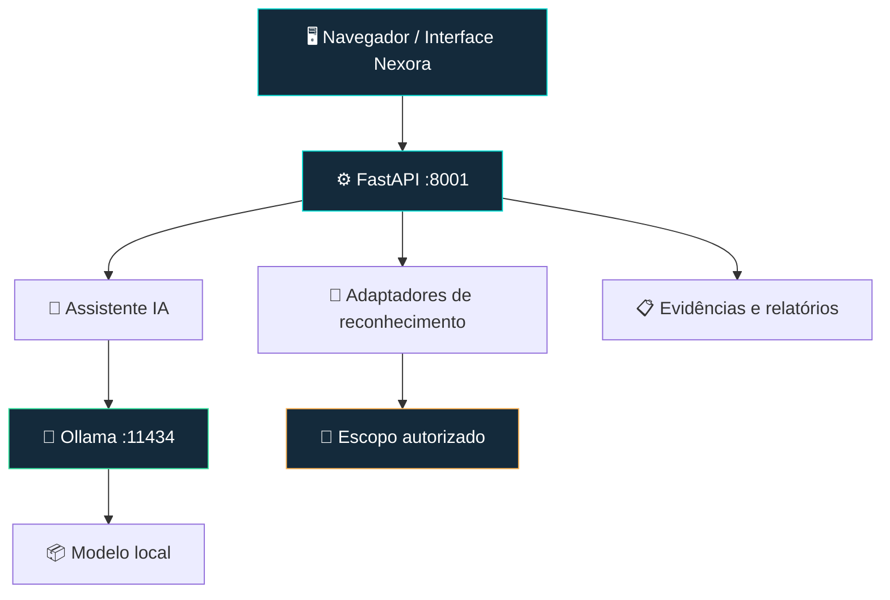
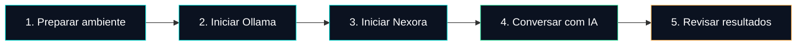

<div align="center">

# ◈ NEXORA SECURITY

### Inteligência local para análise de segurança

[](https://git.io/typing-svg)


**Uma interface para apoiar fluxos de reconhecimento, investigação e documentação de segurança em ambientes autorizados.**

[Visão geral](#-visão-geral) · [Arquitetura](#-arquitetura) · [Instalação](#-instalação-e-configuração) · [Ollama](docs/CONFIGURAR-OLLAMA.md) · [Segurança](#-uso-responsável)

</div>

---

> [!IMPORTANT]
> **Estado atual: v0.1.0-alpha — pré-lançamento.** O código principal do aplicativo já está publicado, mas **não há release estável ou instalação limpa validada**. Alguns scripts de instalação documentados ainda não estão disponíveis. Consulte [versões e roadmap](docs/VERSOES-E-ROADMAP.md).

## ✦ Visão geral

O **Nexora Security** é um projeto experimental de assistência à análise de segurança. A proposta é reunir uma interface web, modelos locais de linguagem e ferramentas de reconhecimento para organizar informações, apoiar decisões e produzir evidências rastreáveis.

<table>
<tr>
<td width="50%" valign="top">

### 🧠 Assistente local

- Conversas de apoio técnico com **Ollama**
- Modelo configurável, incluindo `nexora-ai`
- Processamento local quando o modelo roda na própria máquina

</td>
<td width="50%" valign="top">

### 🔎 Reconhecimento autorizado

- Integrações planejadas com ferramentas de rede e web
- Execução limitada ao escopo autorizado
- Etapas de planejamento e aprovação

</td>
</tr>
<tr>
<td valign="top">

### 📋 Evidências e relatórios

- Organização de achados
- Apoio à documentação de verificações
- Revisão humana das conclusões

</td>
<td valign="top">

### 🛡️ Controle operacional

- Uso em laboratório e ativos próprios/autorizados
- Serviços locais por padrão
- Sem exposição pública do Ollama ou FastAPI

</td>
</tr>
</table>

## ◇ Arquitetura



**Fluxo do chat:** você abre `/chat`, faz uma pergunta, o backend envia a solicitação ao modelo configurado no Ollama e exibe a resposta. Ferramentas de reconhecimento são um fluxo separado, sujeito à autorização e às verificações da aplicação.

## 🚀 Instalação e configuração

Escolha o ambiente:

| Ambiente | Guia | Indicação |
| :-- | :-- | :-- |
| 🐉 Kali Linux / VirtualBox | **[Instalar no Kali](docs/INSTALACAO-KALI-VM.md)** | Laboratório em máquina virtual |
| 🪟 Windows 11 / WSL2 | **[Instalar no Windows](docs/INSTALACAO-WINDOWS.md)** | Ubuntu dentro do Windows |
| 🐧 Ubuntu / Debian | **[Instalar no Linux](docs/INSTALACAO-LINUX.md)** | Ambiente Linux local |
| 🤖 Ollama + modelo de IA | **[Conectar o chat](docs/CONFIGURAR-OLLAMA.md)** | IA local e solução de problemas |
| 🧰 Ferramentas de reconhecimento | **[Instalar e aprender a usar](docs/FERRAMENTAS.md)** | Linux, Kali e Windows/WSL2 |

<details>
<summary><strong>▶ Inicialização local (conforme os arquivos disponíveis)</strong></summary>

```bash
# Na pasta raiz do projeto:
python3 -m venv .venv
source .venv/bin/activate
python -m pip install -r requirements.txt
python -m uvicorn main:app --host 127.0.0.1 --port 8001
```

Abra **http://127.0.0.1:8001/chat**.

> O código principal foi publicado, mas a instalação ainda não foi validada em ambiente limpo. Configure e inicie o Ollama separadamente, conforme o guia. Não execute scripts que não estejam presentes no repositório.

</details>

<details>
<summary><strong>▶ Teste rápido do Ollama</strong></summary>

Após instalar e iniciar o Ollama conforme o [guia completo](docs/CONFIGURAR-OLLAMA.md):

```bash
ollama pull llama3.2
ollama list
ollama run llama3.2 "Responda: NEXORA OK"
curl -fsS http://127.0.0.1:11434/api/tags
```

Para usar um modelo personalizado, verifique o `Modelfile` publicado e o nome efetivo do modelo instalado no Ollama. A configuração pode variar entre instalações.

</details>

## 🧭 Como funciona



## 🗺️ Roadmap

**Versão atual:** `v0.1.0-alpha` — código principal e documentação publicados, sem release estável validada. **Próximas versões planejadas:** `v0.2.0-alpha` (código e scripts), `v0.3.0-beta` (validação das integrações), `v0.4.0-beta` (diagnóstico e testes) e `v1.0.0` (estável). [Ver planejamento completo](docs/VERSOES-E-ROADMAP.md).


- [x] Criar repositório privado e documentação inicial
- [x] Documentar instalação em Kali, Ubuntu e Windows/WSL2
- [x] Documentar integração do Ollama
- [x] Publicar código-fonte principal
- [ ] Publicar e validar scripts de instalação
- [ ] Verificar ausência de segredos e dados sensíveis
- [ ] Validar instalação limpa no Kali e no Ubuntu/WSL2
- [ ] Adicionar capturas reais da interface
- [ ] Preparar uma versão identificada com release notes

## 🔐 Uso responsável

> [!CAUTION]
> Use somente em sistemas próprios ou com **autorização explícita**. Não publique credenciais, tokens, listas privadas de alvos, relatórios de clientes ou dados pessoais. Não exponha `8001` e `11434` à internet. A descoberta de um domínio ou IP **não** concede permissão para testá-lo.

## 🩺 Diagnóstico e recuperação

Se o chat não responder, uma ferramenta não iniciar ou surgir um erro de dependência, use a **[Central de documentação](docs/README.md)**.

| Precisa de ajuda com... | Consulte |
| :-- | :-- |
| Verificar Python, portas, Ollama e ferramentas | [Checklist de diagnóstico](docs/CHECKLIST-DIAGNOSTICO.md) |
| Corrigir erros conhecidos passo a passo | [Solução de problemas — ERR-001 a ERR-014](docs/SOLUCAO-DE-PROBLEMAS.md) |
| Padronizar mensagens, logs e recuperação no código | [Tratamento de erros e observabilidade](docs/TRATAMENTO-DE-ERROS.md) |

## 📚 Documentação

A documentação está organizada por categorias na **[Central de documentação](docs/README.md)**:

- **Projeto e versões:** [Roadmap](docs/VERSOES-E-ROADMAP.md) e [licença](LICENSE).
- **Instalação:** [Linux](docs/INSTALACAO-LINUX.md), [Kali/VirtualBox](docs/INSTALACAO-KALI-VM.md) e [Windows/WSL2](docs/INSTALACAO-WINDOWS.md).
- **Configuração e ferramentas:** [Ollama](docs/CONFIGURAR-OLLAMA.md) e [reconhecimento](docs/FERRAMENTAS.md).
- **Suporte:** [Checklist](docs/CHECKLIST-DIAGNOSTICO.md), [solução de problemas](docs/SOLUCAO-DE-PROBLEMAS.md) e [tratamento de erros (proposta)](docs/TRATAMENTO-DE-ERROS.md).
- **Arquitetura futura:** [Autenticação e licenças offline](docs/ARQUITETURA-AUTENTICACAO-LICENCAS.md) — ainda não implementadas.

## 📄 Licença

**Licença proprietária de uso restrito.** O uso, a execução, a cópia, a modificação, a redistribuição e a exploração comercial do Nexora Security dependem de **autorização prévia e expressa por escrito** do titular dos direitos, ressalvados os direitos legalmente assegurados. O acesso ao repositório não concede uma licença de uso.

Leia os termos completos em **[LICENSE](LICENSE)**. Componentes de terceiros continuam sujeitos às suas próprias licenças.

---

<div align="center">

**NEXORA SECURITY**

`LOCAL FIRST` · `AUTHORIZED SCOPE` · `HUMAN REVIEW`

<sub>Projeto experimental de cibersegurança • Documentação em evolução</sub>

</div>
