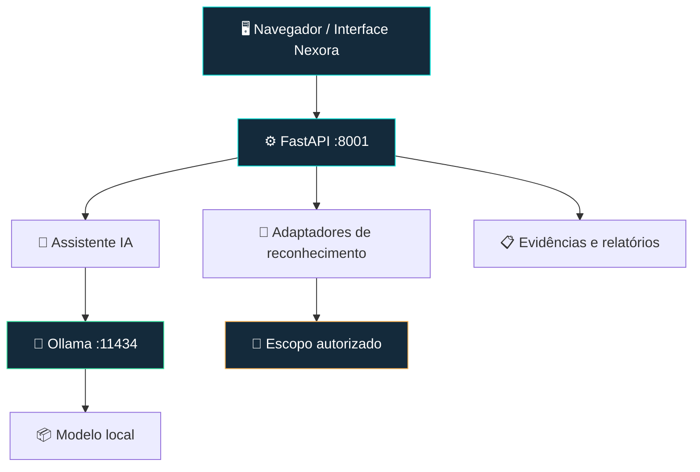
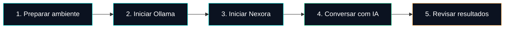

<div align="center">

# ◈ NEXORA SECURITY

### Inteligência local para análise de segurança

[](https://git.io/typing-svg)


**Uma interface para apoiar fluxos de reconhecimento, investigação e documentação de segurança em ambientes autorizados.**

[Visão geral](#-visão-geral) · [Arquitetura](#-arquitetura) · [Instalação](#-instalação-e-configuração) · [Ollama](docs/CONFIGURAR-OLLAMA.md) · [Segurança](#-uso-responsável)

</div>

---

> [!IMPORTANT]
> **Publicação em andamento.** Este repositório contém a documentação inicial, mas **ainda não inclui o código-fonte completo nem os scripts de instalação**. Os procedimentos abaixo são uma referência para quando esses arquivos forem publicados e validados. O projeto é um protótipo local, não um serviço pronto para produção.

## ✦ Visão geral

O **Nexora Security** é um projeto experimental de assistência à análise de segurança. A proposta é reunir uma interface web, modelos locais de linguagem e ferramentas de reconhecimento para organizar informações, apoiar decisões e produzir evidências rastreáveis.

<table>
<tr>
<td width="50%" valign="top">

### 🧠 Assistente local

- Conversas de apoio técnico com **Ollama**
- Modelo configurável, incluindo `linuxsec-ai`
- Processamento local quando o modelo roda na própria máquina

</td>
<td width="50%" valign="top">

### 🔎 Reconhecimento autorizado

- Integrações planejadas com ferramentas de rede e web
- Execução limitada ao escopo autorizado
- Etapas de planejamento e aprovação

</td>
</tr>
<tr>
<td valign="top">

### 📋 Evidências e relatórios

- Organização de achados
- Apoio à documentação de verificações
- Revisão humana das conclusões

</td>
<td valign="top">

### 🛡️ Controle operacional

- Uso em laboratório e ativos próprios/autorizados
- Serviços locais por padrão
- Sem exposição pública do Ollama ou FastAPI

</td>
</tr>
</table>

## ◇ Arquitetura



**Fluxo do chat:** você abre `/chat`, faz uma pergunta, o backend envia a solicitação ao modelo configurado no Ollama e exibe a resposta. Ferramentas de reconhecimento são um fluxo separado, sujeito à autorização e às verificações da aplicação.

## 🚀 Instalação e configuração

Escolha o ambiente:

| Ambiente | Guia | Indicação |
| :-- | :-- | :-- |
| 🐉 Kali Linux / VirtualBox | **[Instalar no Kali](docs/INSTALACAO-KALI-VM.md)** | Laboratório em máquina virtual |
| 🪟 Windows 11 / WSL2 | **[Instalar no Windows](docs/INSTALACAO-WINDOWS.md)** | Ubuntu dentro do Windows |
| 🐧 Ubuntu / Debian | **[Instalar no Linux](docs/INSTALACAO-LINUX.md)** | Ambiente Linux local |
| 🤖 Ollama + modelo de IA | **[Conectar o chat](docs/CONFIGURAR-OLLAMA.md)** | IA local e solução de problemas |

<details>
<summary><strong>▶ Prévia dos comandos de inicialização (após publicação do código)</strong></summary>

```bash
# Na pasta raiz do projeto completo:
bash scripts/install-linux.sh
bash scripts/check.sh
bash scripts/start.sh
```

Abra **http://127.0.0.1:8001/chat**.

> Estes scripts ainda não estão disponíveis no repositório. Não tente executá-los antes de conferir os arquivos publicados.

</details>

<details>
<summary><strong>▶ Teste rápido do Ollama</strong></summary>

Após instalar e iniciar o Ollama conforme o [guia completo](docs/CONFIGURAR-OLLAMA.md):

```bash
ollama pull llama3.2
ollama list
ollama run llama3.2 "Responda: NEXORA OK"
curl -fsS http://127.0.0.1:11434/api/tags
```

Para usar o modelo personalizado `linuxsec-ai`, será necessário o `Modelfile` do projeto completo.

</details>

## 🧭 Como funciona



## 🗺️ Roadmap

- [x] Criar repositório privado e documentação inicial
- [x] Documentar instalação em Kali, Ubuntu e Windows/WSL2
- [x] Documentar integração do Ollama
- [ ] Publicar código-fonte revisado e scripts de instalação
- [ ] Verificar ausência de segredos e dados sensíveis
- [ ] Validar instalação limpa no Kali e no Ubuntu/WSL2
- [ ] Adicionar capturas reais da interface
- [ ] Preparar uma versão identificada com release notes

## 🔐 Uso responsável

> [!CAUTION]
> Use somente em sistemas próprios ou com **autorização explícita**. Não publique credenciais, tokens, listas privadas de alvos, relatórios de clientes ou dados pessoais. Não exponha `8001` e `11434` à internet. A descoberta de um domínio ou IP **não** concede permissão para testá-lo.

## 📚 Documentação

- [Kali Linux no VirtualBox](docs/INSTALACAO-KALI-VM.md)
- [Windows 11 com WSL2](docs/INSTALACAO-WINDOWS.md)
- [Ubuntu e Debian](docs/INSTALACAO-LINUX.md)
- [Configuração completa do Ollama](docs/CONFIGURAR-OLLAMA.md)

## 📄 Licença

**Ainda não definida.** Até que uma licença seja publicada, não presuma autorização de redistribuição ou reutilização do código.

---

<div align="center">

**NEXORA SECURITY**

`LOCAL FIRST` · `AUTHORIZED SCOPE` · `HUMAN REVIEW`

<sub>Projeto experimental de cibersegurança • Documentação em evolução</sub>

</div>
