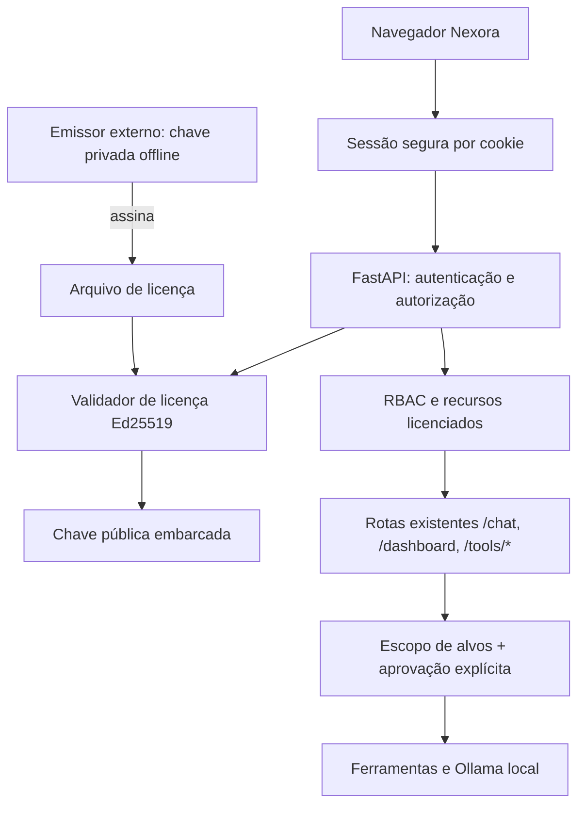

# Arquitetura de autenticação e licenciamento offline — Nexora Security

**Status:** proposta técnica baseada em revisão estática de uma cópia local do código Python. **Não implementado no backend publicado.** Nenhuma rota, tela ou script foi alterado nesta etapa.

## 1. Objetivos e limites

- Login local de usuários autorizados, sem exigir internet.
- Licença offline assinada digitalmente; chave privada **nunca** distribuída com o aplicativo.
- Preservar rotas, HTML/CSS/JavaScript e fluxos existentes; acrescentar login e indicadores de licença sem redesenhar o dashboard.
- Proteger **endpoints e páginas no servidor**, não apenas ocultar botões.
- Continuar exigindo escopo de alvos autorizado e aprovação explícita para operações de reconhecimento.
- Evitar prometer proteção absoluta em instalações nas quais o usuário controla o código e o sistema operacional.

## 2. Achados da revisão estática

A cópia local examinada contém os seguintes módulos:

| Arquivo | Evidência observada | Recomendação |
|---|---|---|
| `main.py` | FastAPI agrega roteadores; `/analyzer` e `/analyze` são rotas diretas | Aplicar autenticação/autorizações a todas as rotas privadas, inclusive rotas diretas |
| `chat_page.py` | `GET /chat` entrega HTML; chamadas JS `fetch` usam URLs relativas | Manter interface e JS; usar cookie de sessão HttpOnly com envio same-origin |
| `dashboard.py` | `GET /dashboard` e iframe `/analyzer` | Proteger ambos e preservar iframe após login |
| `nmap_engine.py` | `/tools/targets`, `/tools/nmap`, `/tools/analyze-nmap`; escopo em `authorized_targets.json` | Adicionar autorização por papel/licença **sem substituir** as verificações de escopo |
| `security_chat.py` | `/tools/chat/plan`, `/run`, `/explain-grep`; aprovação explícita e verificação de alvos | Validar sessão e licença antes do processamento; manter aprovação/escopo |
| `chat_assistant.py` | `/tools/chat/ask` conversa com Ollama local | Exigir usuário autenticado e recurso licenciado |
| `tool_registry.py`, `grep_engine.py`, `dns_recon.py` | Roteadores auxiliares | Inventariar e proteger endpoints, inclusive os somente leitura |

**Riscos:** não foi identificada dependência de autenticação central nas rotas inspecionadas. A interface faz chamadas `fetch` sem mecanismo explícito de sessão. As verificações atuais de escopo de alvos **não equivalem** a autenticação. A revisão não prova que não existam controles externos no ambiente de implantação.

## 3. Componentes propostos



### Módulos sugeridos

- `auth/passwords.py`: Argon2id, parâmetros e verificação segura.
- `auth/users.py`: usuários locais e papéis `admin`/`operator`/`viewer`.
- `auth/sessions.py`: sessões aleatórias de alta entropia, armazenadas como hash no banco; expiração, logout e revogação.
- `licensing/verify.py`: validação Ed25519 de payload canônico, assinatura, validade e identidade da licença.
- `licensing/policy.py`: mapeamento de recursos por plano/permissões.
- `licensing/public_key.pem`: **somente chave pública**.
- `admin/issue_license.py`: ferramenta **separada**, fora do pacote distribuído, que usa chave privada protegida.
- `data/nexora.db`: banco local SQLite para usuários, sessões e eventos; fora do Git, permissões restritas.
- `tests/test_auth.py` e `tests/test_license.py`: testes automatizados.

## 4. Fluxo de autenticação

1. `GET /login` exibe tela dedicada, visual consistente com o Nexora.
2. `POST /auth/login` valida usuário/senha Argon2id e aplica limitação de tentativas.
3. O servidor cria sessão opaca, envia cookie `HttpOnly; SameSite=Lax; Secure` **quando HTTPS** e protege requisições mutáveis contra CSRF.
4. `GET /auth/me` retorna somente dados mínimos do usuário e situação da licença.
5. `POST /auth/logout` invalida a sessão no servidor.
6. Rotas privadas exigem sessão válida; operações sensíveis também exigem papel e licença.

Em `http://127.0.0.1` para desenvolvimento local, o cookie `Secure` precisa de estratégia explícita para ambiente HTTP, **sem levar essa exceção para implantações HTTPS**. Não armazenar tokens de sessão em `localStorage`.

## 5. Licença offline assinada

Formato ilustrativo:

```json
{
  "payload": {
    "schema": 1,
    "license_id": "NX-EXEMPLO-001",
    "subject": "Organizacao autorizada",
    "issued_at": "2026-11-15T00:00:00Z",
    "expires_at": "2027-11-15T00:00:00Z",
    "features": ["chat", "reports", "recon"],
    "max_users": 1
  },
  "signature": "<base64-da-assinatura-ed25519>"
}
```

A assinatura cobre os bytes canônicos do `payload`. A verificação deve rejeitar assinatura inválida, campos inesperados, versão desconhecida, datas inválidas e recursos não concedidos. O emissor usa chave privada isolada; a aplicação contém apenas chave pública.

**Limitações importantes:** revogação imediata não é garantida sem conectividade; um arquivo de revogação assinado pode ser importado manualmente. Alterações no relógio local podem afetar validade; usar último horário observado e registrar anomalias ajuda, mas não elimina manipulação por administradores da máquina. Vincular ao dispositivo pode prejudicar recuperação/privacidade e não é uma barreira infalível.

## 6. Matriz inicial de permissões

| Recurso | viewer | operator | admin |
|---|:---:|:---:|:---:|
| Abrir dashboard e consultar status | ✓ | ✓ | ✓ |
| Usar chat com IA | Se licenciado | Se licenciado | Se licenciado |
| Consultar evidências permitidas | ✓ | ✓ | ✓ |
| Cadastrar alvos e executar ferramentas | — | Se licenciado e autorizado | Se licenciado e autorizado |
| Gerenciar usuários e instalar licença | — | — | ✓ |

A permissão final é a interseção de **papel + licença + escopo autorizado + aprovação da operação**.

## 7. Migração sem alterar a interface atual

1. Criar backup e testes de regressão de rotas e HTML antes das alterações.
2. Adicionar módulos independentes e banco local; não substituir `main.py` inteiro.
3. Implementar login e `/auth/me` com teste de cookies, CSRF e logout.
4. Proteger todas as rotas privadas com dependências FastAPI ou middleware testado; não confiar apenas no JavaScript.
5. Adicionar validação de licença e indicadores discretos na interface, preservando CSS, abas, iframe e fluxos existentes.
6. Criar bootstrap seguro do primeiro administrador via CLI local, sem credencial padrão.
7. Testar licenças válidas, expiradas, adulteradas, revogadas manualmente, e acesso sem licença.
8. Executar testes de regressão de escopo de alvos e de aprovação explícita; validar em Ubuntu/Kali/WSL2.

## 8. Testes de aceitação obrigatórios

- Sem login, `/chat`, `/dashboard`, `/analyzer`, `/analyze` e `/tools/*` não disponibilizam dados/ações privados.
- `/login` e endpoints necessários à autenticação permanecem acessíveis.
- Sessão inválida/expirada é rejeitada; logout invalida sessão imediatamente.
- Login incorreto recebe mensagem genérica e limitação de tentativas.
- POST sem token CSRF válido é rejeitado quando autenticado por cookie.
- Licença com assinatura alterada, vencida ou com feature ausente é rejeitada.
- Usuário sem papel necessário recebe `403`; sem autenticação recebe `401` em APIs.
- Mesmo com licença válida, alvo fora de escopo e operação sem aprovação continuam bloqueados.
- Dashboard, chat, iframe e ferramentas preservam comportamento visual e funcional em testes de regressão.
- Nenhuma chave privada, senha, banco local ou arquivo de licença de cliente é commitado.

## 9. Decisões pendentes antes de codificar

- Confirmar a versão do código em execução: o GitHub ainda não contém o backend completo.
- Escolher se o licenciamento cobre instalação, usuário ou organização.
- Definir política de expiração (licenças permanentes ou temporárias) e processo manual de revogação.
- Definir se o primeiro administrador será criado por comando local de bootstrap (recomendado).

[Central de documentação](README.md)
